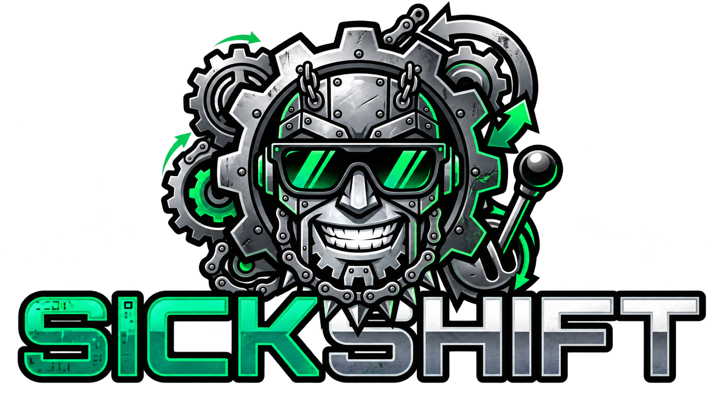
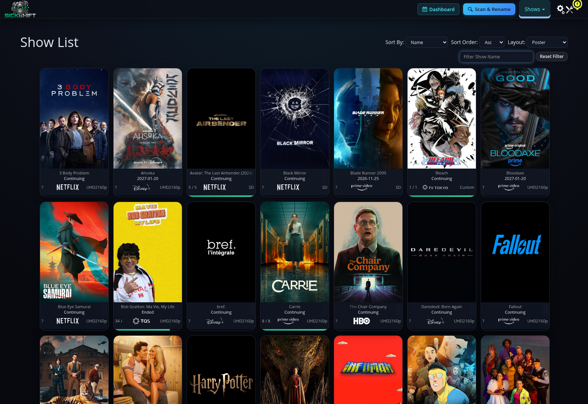
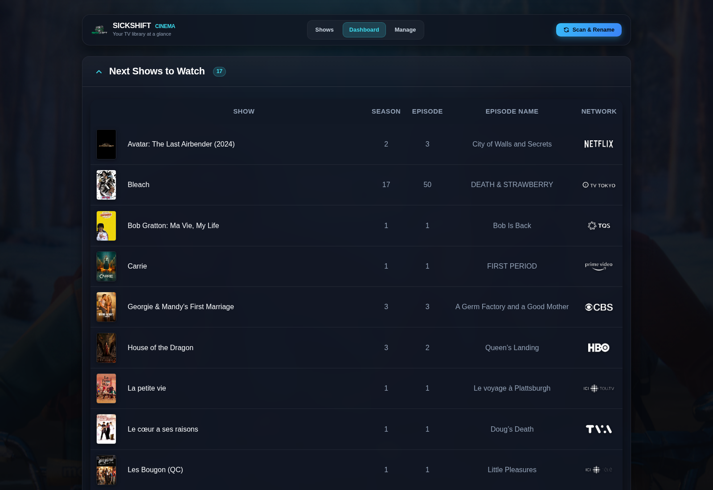

<p align="center"></p>

<h1 align="center">Your next great night in starts here.</h1>

<p align="center"><strong>Your TV library, in a whole new light.</strong><br>
SickShift is an independent fork of <a href="https://github.com/SickGear/SickGear">SickGear</a>, combining its TV-show management engine with a cinema-inspired interface, a dedicated dashboard, and local video previews.</p>

<p align="center"><a href="#features">Features</a> · <a href="#screenshots">Screenshots</a> · <a href="#getting-started">Get started</a> · <a href="docs/COMPARISON.md">Compare with SickGear</a></p>

## Your shows, front and center

Track your series, find missing episodes, discover what's coming next, and browse the episodes you already have — all from an interface designed to make your library easier to explore.

## Features

- **A cinematic library.** Poster-focused cards, network branding, progress indicators, and a refined dark interface make it easy to find your next episode.
- **One dashboard for your collection.** See episodes ready to watch, missing episodes, finished series, and upcoming airings together.
- **Instant local previews.** Preview episodes from your own files by hovering over them on supported desktop devices. Playback controls and reusable clips make browsing smoother. FFmpeg is required.
- **A clearer view of what's missing.** Group missing episodes by series and copy episode references with immediate feedback.
- **A layout that remembers you.** Expand or collapse dashboard sections; your browser keeps your preferences.
- **More dependable file handling.** Scan-and-rename results reflect actual file moves, rather than reporting a move as successful before it happens.
- **The SickGear foundation.** Keep the established show tracking, metadata, search, and integration capabilities of the underlying project.

For a technical breakdown of what is new, inherited, or limited, see [SickShift compared with SickGear](docs/COMPARISON.md). Local previews are intended for supported desktop layouts; mobile and touch-only layouts do not offer hover previews.

## Screenshots

### Your library

Browse series with poster artwork, progress indicators, and quick access to show management.

[](docs/assets/main-en.png)

### Your dashboard

See what's available, what's missing, and what's coming next.

[](docs/assets/dashboard-en.png)

## Getting started

Install **Python** and **Git**, then clone and launch SickShift. On first launch, the application prepares an isolated Python environment and installs missing Python dependencies when needed.

**Linux / macOS**

```sh
git clone https://github.com/pomercier/SickShift.git
cd SickShift
python3 sickshift.py --nolaunch --datadir ./data
```

**Windows**

```powershell
git clone https://github.com/pomercier/SickShift.git
cd SickShift
py sickshift.py --nolaunch --datadir ./data
```

Open the local address shown in the startup logs to set up your TV library.

**Want video previews?** Install the native **FFmpeg** and **ffprobe** executables separately. Ordinary show management does not require them. First launch needs internet access to download missing Python packages, and the installation directory must be writable.

For supported Python versions, video-format requirements, configuration options, managed environments, and service setup, follow the [installation guide](docs/INSTALLATION.md). A [systemd service example](packaging/sickshift.service.example) is also available.

## Documentation

- [Installation and configuration](docs/INSTALLATION.md)
- [SickShift vs. SickGear: changes and limitations](docs/COMPARISON.md)
- [Contributing and reporting issues](CONTRIBUTING.md)
- [Upstream integration and updates](docs/UPSTREAM.md)
- [Privacy and publication notes](docs/PRIVACY.md)

## Credits and license

SickShift is an independent, unofficial fork of [SickGear](https://github.com/SickGear/SickGear), which traces its origins to Sick-Beard. The project retains upstream attribution and original copyright notices.

Licensed under [GPL-3.0](COPYING.txt).
