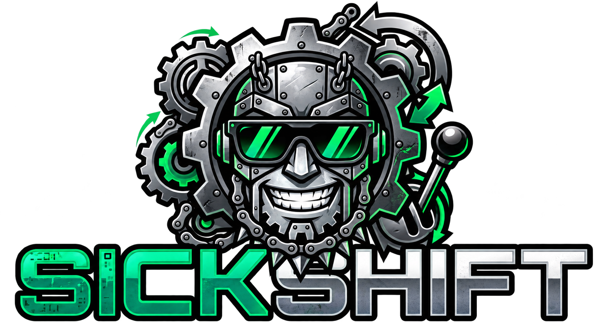
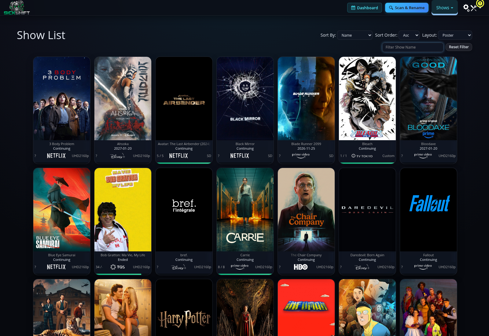
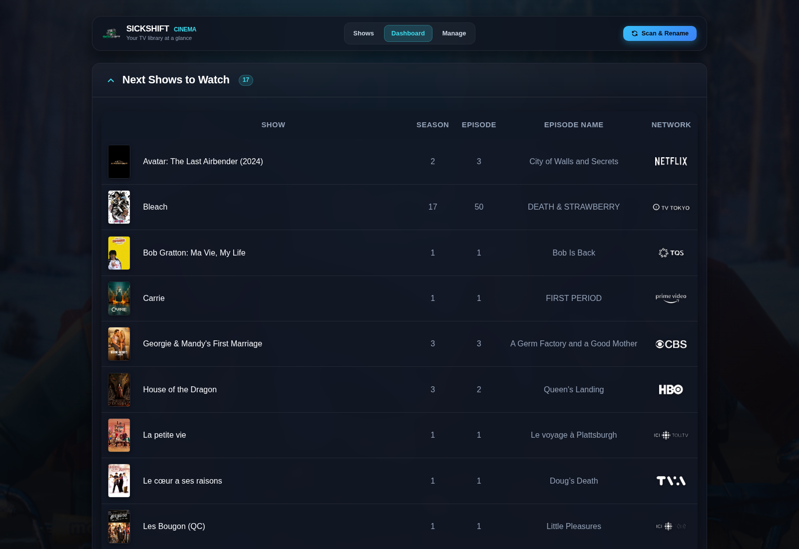

<p align="center"></p>

<h1 align="center">Your next great night in starts here.</h1>

<p align="center">
  <a href="https://github.com/pomercier/SickShift/releases"></a>
  <a href="https://github.com/pomercier/SickShift/actions/workflows/sickshift-ci.yml"></a>
  <a href="https://github.com/pomercier/SickShift/actions/workflows/upstream-watch.yml"></a>
  <a href="https://github.com/pomercier/SickShift/pkgs/container/sickshift"></a>
  <a href="COPYING.txt"></a>
</p>

<p align="center"><strong>Your TV library, in a whole new light.</strong><br>
SickShift is an actively maintained fork of <a href="https://github.com/SickGear/SickGear">SickGear</a>, combining its proven TV-show management engine with a cinema-inspired interface, a dedicated dashboard, local video previews, automated upstream synchronization, and a single official multi-architecture Docker image.</p>

<p align="center">
  <a href="#features">Features</a> ·
  <a href="#official-docker-image">Official Docker Image</a> ·
  <a href="#getting-started">Get Started</a> ·
  <a href="https://github.com/pomercier/SickShift/releases">Releases</a> ·
  <a href="CHANGELOG.md">Changelog</a> ·
  <a href="docs/COMPARISON.md">Compare with SickGear</a>
</p>

## Your shows, front and center

Track your series, find missing episodes, discover what's coming next, and browse the episodes you already have — all from a refined interface designed to make your library easier to explore while staying continuously synchronized with upstream SickGear.

## Features

- **A cinematic library.** Poster-focused cards, network branding, accurate non-skipped progress indicators (including distinct `0 / 0` status bars), and a refined dark interface.
- **One dashboard for your collection.** See episodes ready to watch, missing episodes, finished series, and upcoming airings (excluding already-downloaded episodes) together, plus a live Diagnostics & Health modal.
- **Instant local previews.** Preview episodes from your own files by hovering over them on supported desktop devices, with hardware-accelerated FFmpeg support (CPU fallback) and automatic 1-hour preview cache purging.
- **Safer operations.** Automatic daily hot SQLite backups (`sqlite3.backup()`, 7-day rolling retention), non-destructive migration from legacy `sickbeard.db` to `sickshift.db`, and one-click episode deletion with confirmation.
- **Automated upstream tracking.** Continuous upstream SickGear monitoring with deterministic conflict resolution, automated validation, independent watchdog monitoring, and simplified owner arbitration when a deliberate decision is needed.
- **The SickGear foundation.** Retains the full show tracking, metadata, search, ECH/tunnel fallback, video codec badges, and provider integrations of upstream SickGear.

For a detailed comparison, see [SickShift compared with SickGear](docs/COMPARISON.md) and the [Customizations Registry](docs/CUSTOMIZATIONS_REGISTRY.md).

## Official Docker Image

**Registry & official image:** [`ghcr.io/pomercier/sickshift`](https://github.com/pomercier/SickShift/pkgs/container/sickshift) (`linux/amd64`, `linux/arm64`)

> SickShift is actively intended to follow upstream SickGear development while preserving its own features and improvements.
>
> My goal is to keep SickShift and its official Docker image as up to date as reasonably possible through automated upstream synchronization, validation, and release workflows.
>
> There is one official SickShift Docker image (`ghcr.io/pomercier/sickshift`). This image is intended to remain the project's long-term Docker distribution channel.
>
> Users do not need to switch between different official Docker repositories when updating SickShift. Stable versions are distributed through versioned tags within the same official image.
>
> The `latest` tag points to the most recent validated stable release. Versioned tags (such as `1.3.0` and `1.3`) are available for users who prefer predictable deployments or need to roll back.
>
> Upstream changes are integrated automatically whenever they can be safely validated. Changes requiring a deliberate human decision are reviewed before being published.
>
> This is a best-effort maintenance commitment, not a guarantee of uninterrupted availability or immediate upstream compatibility.

### Install with Docker Compose

Use the included [`docker-compose.yml`](docker-compose.yml):

```yaml
services:
  sickshift:
    image: ghcr.io/pomercier/sickshift:latest
    container_name: sickshift
    restart: unless-stopped
    ports:
      - "8081:8081"
    environment:
      - TZ=America/Toronto
      - SICKSHIFT_PREVIEW_CACHE_MAX_MB=500
    volumes:
      - ./data:/data
      - ./shows:/shows
```

```sh
docker compose up -d
```

Open `http://localhost:8081` (or `http://localhost:8081/dashboard`). Legacy `sickbeard.db` files inside `/data` are automatically and non-destructively migrated to `sickshift.db` on first startup.

### Update to the latest validated release

```sh
docker compose pull
docker compose up -d
```

### Pin or roll back to a specific version

Every stable release publishes an immutable multi-architecture tag (for example `ghcr.io/pomercier/sickshift:1.3.0`). To pin or roll back, replace `:latest` in `docker-compose.yml` with the desired version tag and run:

```sh
docker compose pull
docker compose up -d
```

For full container policies, healthchecks, volumes, and rollback instructions, see [DOCKER_POLICY.md](docs/DOCKER_POLICY.md).

## Screenshots

### Your library

[](docs/assets/main-en.png)

### Your dashboard

[](docs/assets/dashboard-en.png)

## Getting started (native Python)

Install **Python 3.11+** and **Git**, then clone and launch SickShift. On first launch, SickShift prepares its dependencies automatically.

**Linux / macOS**

```sh
git clone https://github.com/pomercier/SickShift.git
cd SickShift
python3 sickshift.py --nolaunch --datadir ./data
```

**Windows**

```powershell
git clone https://github.com/pomercier/SickShift.git
cd SickShift
py sickshift.py --nolaunch --datadir ./data
```

Install **FFmpeg** and **ffprobe** separately if you want hover video previews. Ordinary show management does not require them. For full installation, systemd service, and configuration details, see [docs/INSTALLATION.md](docs/INSTALLATION.md).

## Releases & Issue Reporting

- **Official releases:** [GitHub Releases](https://github.com/pomercier/SickShift/releases)
- **Changelog:** [CHANGELOG.md](CHANGELOG.md)
- **Report a bug or request a feature:** [GitHub Issues](https://github.com/pomercier/SickShift/issues)

## Documentation

- **Users:** [Installation](docs/INSTALLATION.md) · [Docker Policy](docs/DOCKER_POLICY.md) · [SickShift vs. SickGear](docs/COMPARISON.md) · [Privacy](docs/PRIVACY.md) · [Contributing](CONTRIBUTING.md)
- **Maintenance & Operations:** [Upstream Sync & Architecture](docs/SYNC_ARCHITECTURE.md) · [Owner Arbitration Guide](docs/ARBITRATION_GUIDE.md) · [Sync Runbook](docs/SYNC_RUNBOOK.md) · [Release Policy](docs/RELEASE_POLICY.md) · [Customizations Registry](docs/CUSTOMIZATIONS_REGISTRY.md)

## Credits and license

SickShift is an independent, unofficial fork of [SickGear](https://github.com/SickGear/SickGear), which traces its origins to Sick-Beard. The project retains upstream attribution and original copyright notices.

Licensed under [GPL-3.0](COPYING.txt).
