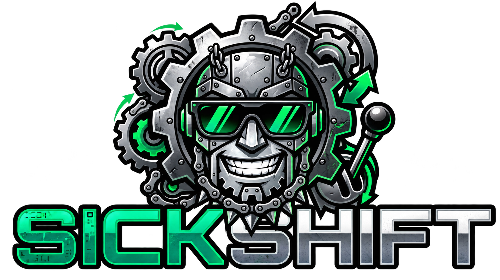
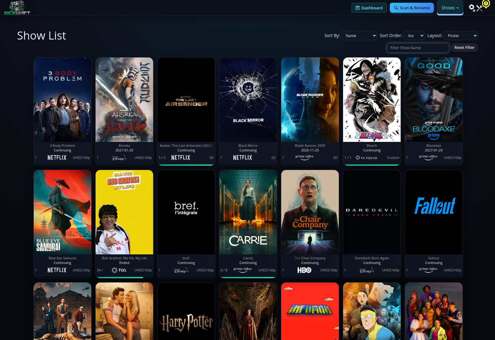
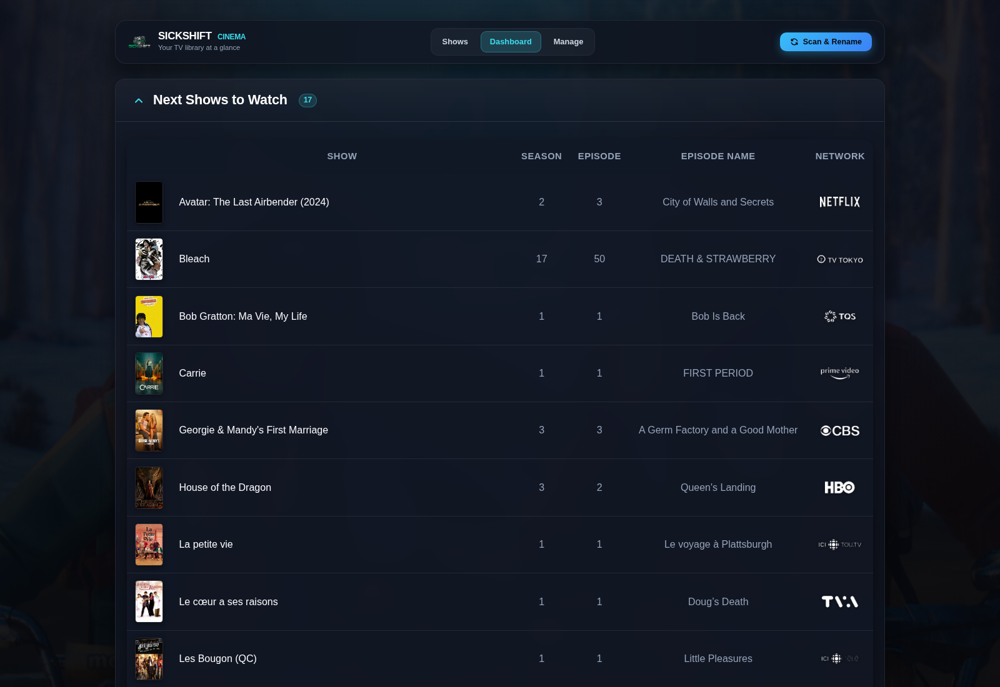

<p align="center"></p>
<h1 align="center">Your next great night in starts here.</h1>
<p align="center"><strong>The SickGear engine. The SickShift experience.</strong><br>An independent fork that brings a cinema-inspired interface, a clearer view of your shows, and local episode previews to your TV library.</p>
<p align="center"><a href="#getting-started">Get started</a> · <a href="docs/COMPARISON.md">Compared with SickGear</a> · <a href="docs/UPSTREAM.md">Protected upstream updates</a> · <a href="docs/PRIVACY.md">Privacy</a></p>

## Put your shows in the spotlight

**A cinema-inspired dashboard.** See episodes ready to watch, missing episodes, completed shows, and upcoming airings in one consistent view. Collapse sections when you need less detail; your browser remembers your preferences.

**Preview before you choose.** Hover over a local episode to play a short clip generated with FFmpeg. Previews use browser-friendly 8-bit H.264. HDR10 and HLG are converted to SDR; Dolby Vision Profile 5 conversion uses libplacebo and requires a compatible Vulkan device.

**Less friction, more watching.** Copy missing-episode references with clear confirmation, browse episodes grouped by show, and see consistent typography throughout. Scan-and-rename results report actual file paths rather than treating a proposed filename as a successful move.

**A proven foundation.** SickShift retains the management, search, metadata, and integration engine from [SickGear](https://github.com/SickGear/SickGear). Inherited features retain their own requirements and configuration.

## Take a look

### Main library

A poster-first view with network logos, episode progress, and quick access to show management.

[](docs/assets/main-en.png)

### Dashboard

A focused view of what is ready to watch, with local previews, collapsible sections, and missing-episode tools.

[](docs/assets/dashboard-en.png)

These screenshots are published with the library owner's permission. Interface labels were translated locally for the images only; they do not change the application's language settings. Show names and poster artwork retain their original branding. Only the final PNGs are included in the repository; the capture tooling is not.

## What SickShift adds

| Improvement | What changes in everyday use |
|---|---|
| Cinema styling | Dark surfaces, clear hierarchy, poster cards, transparent branding, and consistent navigation |
| Library progress | Progress bars and completion styling make the state of each show easier to scan |
| Dedicated dashboard | Ready-to-watch episodes, missing episodes, ended shows, and upcoming airings in one place |
| Local video previews | Hover or hold to preview an existing local episode without opening a full player |
| Browser-friendly preview output | Small 8-bit H.264 clips, with HDR10/HLG conversion and a dedicated Dolby Vision Profile 5 path |
| Audio track selection | Quebec/Canadian French preference, then standard French, English, and the first available track |
| Preview playback controls | Play/pause, mute, seeking, looping, remembered mute preference, and muted autoplay fallback |
| Efficient preview caching | Converted clips are reused; source changes and encoding revisions invalidate stale entries |
| More reliable interactions | Slow responses from a previous episode cannot replace the current preview; delete controls do not trigger preview navigation |
| Missing-episode shortcuts | Per-show groups, copy-to-clipboard feedback, and matching typography for single episodes |
| Remembered section layout | Accessible chevrons, expanded first-visit defaults, and browser-local open/closed preferences |
| Verified rename reporting | The result shows the actual path and reports failed or incomplete moves |
| Video-first rename safety | An associated file moving successfully cannot hide a failed video move and produce a false database path |
| Artwork interactions | Hold-to-zoom treatments for cast and poster images in the show view |
| Regional presentation | Additional Quebec flags and network-logo handling |
| Easier first launch | Automatic isolated Python environment and installation of missing application packages |
| Reviewed upstream integration | Update branches, privacy checks, required CI checks, and protected pull-request merges |

These are changes visible in the compared source tree. SickGear's underlying provider, search, metadata, and downloader capabilities remain upstream features, not new SickShift inventions. [Read the detailed comparison and limitations](docs/COMPARISON.md).

## Getting started

Install Python first, then clone and launch SickShift. The launcher creates a private `.venv`, installs missing Python packages, and starts the application. You do not need to activate an environment or run pip yourself.

**Linux / macOS**

```sh
git clone https://github.com/pomercier/SickShift.git
cd SickShift
python3 sickshift.py --nolaunch --datadir ./data
```

**Windows**

```powershell
git clone https://github.com/pomercier/SickShift.git
cd SickShift
py sickshift.py --nolaunch --datadir ./data
```

If Python is already running inside an isolated environment, the launcher reuses it. Packages are downloaded only when required modules are missing. It never uses `--break-system-packages` or a global `--user` installation. Internet access and a writable installation directory are needed on first launch. On Debian/Ubuntu, `python3-venv` may need to be installed separately. Set `SICKSHIFT_NO_AUTO_INSTALL=1` for a managed environment, or `SICKSHIFT_VENV` to choose another isolated environment location.

FFmpeg and ffprobe are separate native tools: install them through your operating system for video previews. The Python package installer does not install native executables. See [installation details](docs/INSTALLATION.md).

Open the address printed in the logs and configure your own library. **No personal database, library, show list, installation configuration, or service credentials are included.**

For a Linux service, adapt the [systemd example](packaging/sickshift.service.example).

Optional TMDB network-logo lookups use your own `SICKSHIFT_TMDB_API_KEY` environment variable. The application does not automatically load a `.env` file.

## Keep upstream improvements. Protect your changes.

Show-data and dependency updates retain their usual mechanisms. Direct application code replacement is blocked: upstream changes go through an integration branch, tests, and a pull request. A weekly workflow flags new upstream commits without modifying your code.

This prevents automatic overwrites; **it does not promise conflict-free merges**. Renamed modules and interface changes sometimes need manual adaptation. Read the [integration guide](docs/UPSTREAM.md) before updating an installation.

## Development and project status

```sh
python scripts/check_release.py
python -m compileall -q sickshift sickshift_dashboard
python -m unittest tests.preview_clip_tests tests.release_privacy_tests -v
```

The repository includes publication privacy checks and real FFmpeg conversion tests for SDR, 10-bit SDR, HDR10, and HLG. Fork-specific Linux/Python checks replace the inherited upstream CI configuration. Check the repository's Actions tab for current results; a workflow file alone is not proof that a build has passed. Dolby Vision conversion depends on the host hardware and is not covered by a universal GPU test.

Screenshots of real personal libraries are deliberately excluded. Browser display preferences are local to each browser and are not synchronized across accounts or devices.

## Credits and license

SickShift is an independent fork of SickGear, itself descended from Sick-Beard. It is not an official SickGear release. Original copyright notices and attribution are retained; the code is distributed under [GPL-3.0](COPYING.txt).

See the [technical comparison](docs/COMPARISON.md), [contribution guidelines](CONTRIBUTING.md), and [privacy notes](docs/PRIVACY.md).
